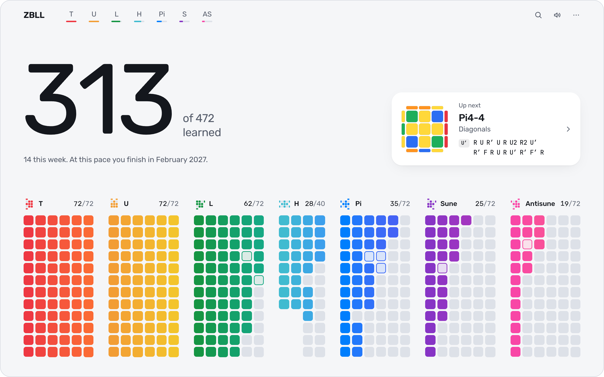
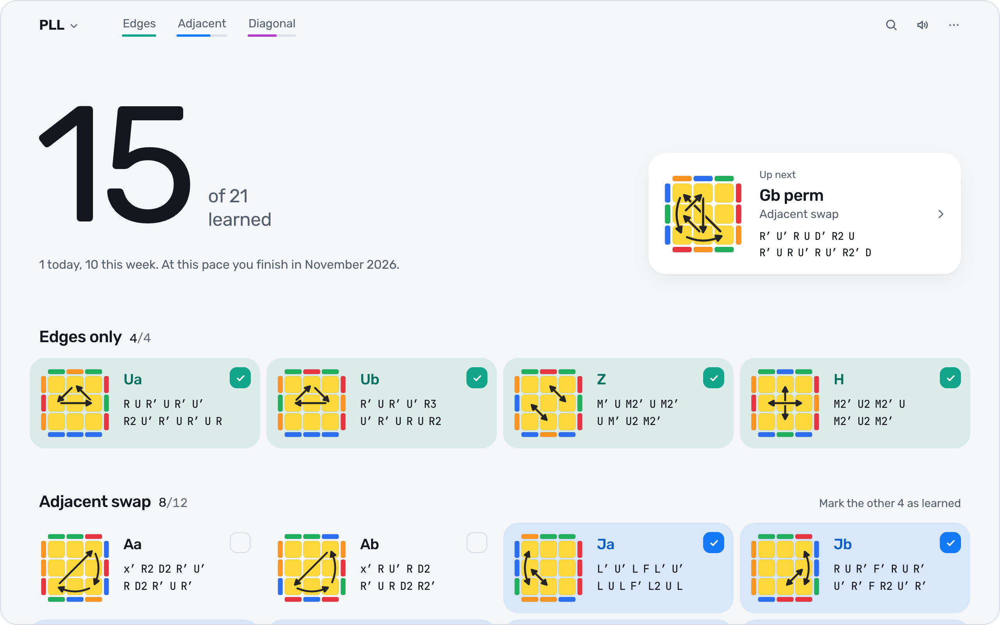

# ZB Tracker

A simple trainer for the full ZB method. Track every ZBLS and ZBLL case you know, choose your algorithms, and keep notes on recognition and AUF.

<picture>
  <source media="(prefers-color-scheme: dark)" srcset="docs/home-dark.png">
  
</picture>

## Features

- **Progress at a glance.** Every case is a square that lights up when you learn it.
- **Your choice of algorithms.** Use one or two per case, two-handed or one-handed, or add your own and have it checked as you type.
- **Recognition and AUF notes.** Kept separately for each angle you solve from.
- **A trainer.** Drill the cases you’re learning, and the learned ones as they come due again, against the clock. Scrambles are built from other cases’ algorithms, so they never give the case away. Afterwards you see the case the way it came up, with your algorithm and AUF from that side. No cube to hand? Recall them from pictures instead.
- **Search.** Jump to a case by name, or paste an algorithm to find the case it solves.
- **No account.** Progress is saved in your browser, and you can export it at any time.
- **PLL as well.** All 21 cases on one page, with Yiheng Wang’s algorithms and fingertricks first. Switch to it from the name at the top left.

<picture>
  <source media="(prefers-color-scheme: dark)" srcset="docs/pages-dark.png">
  
</picture>

<picture>
  <source media="(prefers-color-scheme: dark)" srcset="docs/pll-dark.png">
  
</picture>

## Development

Requires Node 22.12 or newer.

```bash
npm install
npm run dev
```

`npm run build` writes the production site to `dist`, and `npm test` simulates every algorithm against its case, and a trainer scramble for every case.

Built with React, TypeScript and Vite. ZBLL data is generated by [`tools/build_data.py`](tools/build_data.py) from the spreadsheet, and PLL data by [`tools/build_pll.py`](tools/build_pll.py) from [`tools/pll.txt`](tools/pll.txt).

## Credits

ZBLL algorithms compiled by Juliette Sébastien, with spreadsheet layout by Thibaud Ou. The main PLL algorithms are Yiheng Wang’s, as shown in [a video by CubeMaster](https://www.youtube.com/watch?v=vSOp5nAudys), and the others are from [SpeedcubeQuest](https://speedcube.quest/algorithms/3x3/pll).
