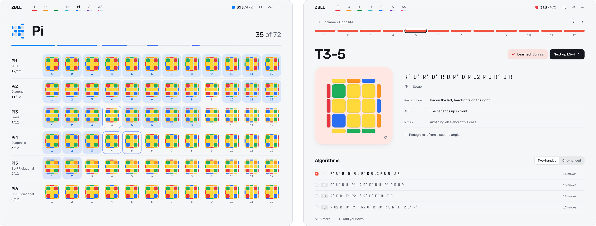

# ZB Tracker

A simple trainer for the full ZB method. Track every ZBLS and ZBLL case you know, choose your algorithms, and keep notes on recognition and AUF.

<picture>
  <source media="(prefers-color-scheme: dark)" srcset="docs/home-dark.png">
  
</picture>

## Features

- **Progress at a glance.** Every case is a square that lights up when you learn it.
- **Your choice of algorithms.** Use one or two per case, two-handed or one-handed, or add your own and have it checked as you type.
- **Recognition and AUF notes.** Kept separately for each angle you solve from.
- **Search.** Jump to a case by name, or paste an algorithm to find the case it solves.
- **No account.** Progress is saved in your browser, and you can export it at any time.

<picture>
  <source media="(prefers-color-scheme: dark)" srcset="docs/pages-dark.png">
  
</picture>

## Development

Requires Node 22.12 or newer.

```bash
npm install
npm run dev
```

`npm run build` writes the production site to `dist`, and `npm test` simulates every algorithm against its case.

Built with React, TypeScript and Vite. Case data is generated by [`tools/build_data.py`](tools/build_data.py).

## Credits

ZBLL algorithms compiled by Juliette Sébastien, with spreadsheet layout by Thibaud Ou.
